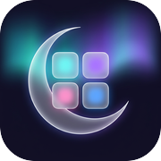

<div align="center">
  <br />
  
  <h1>Mirsa · مرسى</h1>
  <p><strong>غيّر تفاصيل آيفونك، على ذوقك.</strong><br />Make your iPhone feel like yours.</p>
  <p>Wallet artwork, passcode themes and lock-screen wallpapers.<br />On your device. No jailbreak required on supported iOS versions.</p>
  <p><code>iPhone</code> &nbsp; <code>Swift + Rust</code> &nbsp; <a href="LICENSE">MIT License</a></p>
  <br />
  <p><a href="#install">Install</a> &nbsp; · &nbsp; <a href="#customize">Customize</a> &nbsp; · &nbsp; <a href="#compatibility">Compatibility</a> &nbsp; · &nbsp; <a href="#build">Build</a></p>
</div>

---

## Install

**Start with Mirsa Setup.** Add the Mirsa source to your installer's source settings, then select **Mirsa Setup** from the catalog.

```text
https://github.com/Alaaaya/Mirsa/releases/download/setup/source.json
```

<details>
<summary><strong>Need a direct source link?</strong></summary>

If your installer has trouble with release-download redirects, use this alternative.

```text
https://raw.githubusercontent.com/Alaaaya/Mirsa/main/source.json
```

Both addresses serve the Mirsa catalog.

</details>

The source is an app catalog, not an installation profile. You still need a signing or sideloading method appropriate for your device to install an IPA.

## Customize

| In Mirsa | What you can change |
| :--- | :--- |
| **Wallet artwork** | Choose card backgrounds, detect your cards and apply artwork individually or in a batch. Only the appearance changes, not the card itself. |
| **Passcode themes** | Frame an image across the keypad or create separate button cutouts. Preview and reposition your design, then share it as a `.passthm` theme. |
| **Lock-screen wallpapers** | Import `.tendies` archives from Files and apply their PosterBoard assets. Respring after installation to refresh the lock screen. |

## Compatibility

Check your iOS version **before installing or updating**. Support depends on the underlying file-injection method, and individual features may behave differently between releases.

| iOS version | Pairing and support |
| :--- | :--- |
| **18 through 26** | Import an existing pairing record. |
| **27.0 through 27.2 beta 2** | Import a record, or use on-device pairing where available. |
| **27.2 beta 3 and later** | **Not supported.** The underlying method is patched. |

These are the project's stated compatibility limits. Back up your device before changing system caches.

## Connect your iPhone

Mirsa needs two things before it can apply changes.

| Requirement | Purpose |
| :--- | :--- |
| **Pairing record** | Authorizes access to your iPhone's device services. Keep it private. |
| **Local loopback tunnel** | Lets Mirsa reach services on your own phone. Use LocalDevVPN or a suitable WireGuard configuration. |

<details>
<summary><strong>Import a pairing record</strong></summary>

Open Mirsa's **Pairing** tab and import your record from Files.

Supported formats are `.mobiledevicepairing`, `.plist` and `.mobilepair`.

If you use SideStore, look for `ALTPairingFile.mobiledevicepairing` in its Files folder. Otherwise, export a record using a pairing tool and transfer it to your iPhone.

Keep the local tunnel active while using features that require device-service access.

</details>

<details>
<summary><strong>Pair directly on a supported iPhone</strong></summary>

On compatible iOS 27 releases, choose **Pair This iPhone** in Mirsa.

Keep the displayed PIN handy, follow the Developer Mode pairing prompt in Settings, then return to Mirsa to finish.

On-device pairing is not available on every supported iOS version. Import an existing record if the option is unavailable.

</details>

## Build

Build locally on a **Mac with Xcode** and the iOS SDK required by the checked-out source.

| Tool | When you need it |
| :--- | :--- |
| **Xcode + iOS SDK** | Building the iOS app. |
| **XcodeGen** | Regenerating the Xcode project. |
| **Rust** | Rebuilding the native core. |

<details>
<summary><strong>Clone and build the unsigned IPA</strong></summary>

```sh
git clone https://github.com/Alaaaya/Mirsa-iOS.git
cd Mirsa-iOS
./build-ipa.sh
```

The unsigned IPA is placed in `build/`. Sign it using your own installation setup.

To rebuild the Rust framework first, run `./build-ios.sh` before `./build-ipa.sh`.

</details>

| Source | Location |
| :--- | :--- |
| iOS application | [`ios-app/`](ios-app/) |
| Native core | [`rust-core/`](rust-core/) |
| App build script | [`build-ipa.sh`](build-ipa.sh) |
| Native build script | [`build-ios.sh`](build-ios.sh) |

## Credits & license

Mirsa is based on [AirCard-iOS by mak5er](https://github.com/mak5er/AirCard-iOS), with contributions and research from merybist, Johnny Franks / AirLift, and the NeoSpring authors skadz108, rooootdev and neonmodder123.

Original copyright notices and component licenses remain in their respective files. Distributed under the [MIT License](LICENSE).

---

<div align="center">
  <p><strong>Mirsa · مرسى</strong></p>
  <p><a href="https://x.com/rasmtk30">Follow @rasmtk30 on X</a></p>
  <sub>Personalize your iPhone. Keep it yours.</sub>
  <br /><br />
</div>
