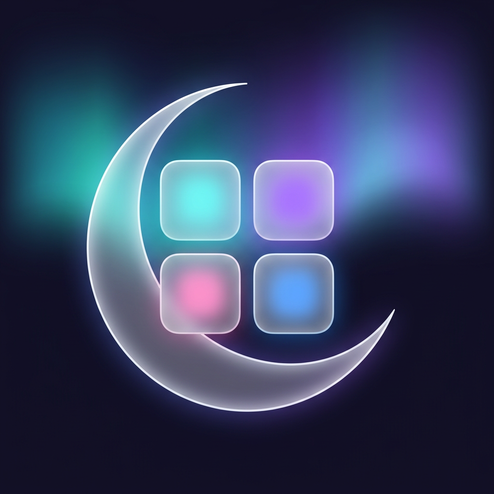

<div align="center">
  
  <h1>Mirsa · مرسى</h1>
  <p>غيّر تفاصيل آيفونك، على ذوقك.<br />Make your iPhone feel like yours.</p>
  <p>
    
    
    <a href="LICENSE"></a>
  </p>
  <p>Wallet artwork, passcode themes and custom lock-screen wallpapers.<br />Applied on your device, without a jailbreak, on compatible iOS versions.</p>
  <p><a href="#get-mirsa">Get Mirsa</a> · <a href="#your-toolbox">Your toolbox</a> · <a href="#before-you-start">Before you start</a> · <a href="https://x.com/rasmtk30">Follow @rasmtk30</a></p>
</div>

---

<h2 id="get-mirsa">Get Mirsa</h2>

Add the Mirsa source to a compatible source-based installer. Copy this address into its source settings, then select Mirsa Setup.

```text
https://github.com/Alaaaya/Mirsa/releases/download/setup/source.json
```

The source is an app catalog, not an installation profile. Installing an IPA still requires a signing or sideloading method appropriate for your device.

<h2 id="your-toolbox">Your toolbox</h2>

<table>
  <tr>
    <td width="33%" valign="top">
      <sub>01 / WALLET</sub>
      <h3>New artwork. Same cards.</h3>
      <p>Choose custom card backgrounds, detect your cards and apply artwork individually or in a batch. Changes affect appearance, not the card itself.</p>
    </td>
    <td width="33%" valign="top">
      <sub>02 / PASSCODE</sub>
      <h3>A dialer of your own.</h3>
      <p>Frame an image across the keypad or create separate button cutouts. Preview the result, adjust its position and share themes as <code>.passthm</code> files.</p>
    </td>
    <td width="33%" valign="top">
      <sub>03 / WALLPAPERS</sub>
      <h3>Beyond a still image.</h3>
      <p>Import <code>.tendies</code> archives from Files and apply their PosterBoard assets. A respring refreshes the lock screen after installation.</p>
    </td>
  </tr>
</table>

<h2 id="before-you-start">Before you start</h2>

Mirsa needs a pairing record and an active local loopback tunnel, such as LocalDevVPN or a suitable WireGuard configuration. The tunnel lets the app reach services on your own phone.

<table>
  <tr><th align="left">Device software</th><th align="left">Pairing route</th></tr>
  <tr><td>iOS 18 through 26</td><td>Import an existing pairing record.</td></tr>
  <tr><td>iOS 27.0 through 27.2 beta 2</td><td>Import a record or use on-device pairing where available.</td></tr>
  <tr><td>iOS 27.2 beta 3 and later</td><td>The underlying file-injection method is patched. Not supported.</td></tr>
</table>

These are the project's stated compatibility limits; individual features can behave differently between releases. Back up your device before changing system caches, and check compatibility before updating iOS.

<details>
<summary><strong>Connect your iPhone</strong></summary>

Open Mirsa's Pairing tab and import a pairing record from Files. Supported extensions include `.mobiledevicepairing`, `.plist` and `.mobilepair`.

If you already use SideStore, look for `ALTPairingFile.mobiledevicepairing` in its Files folder. Other pairing tools can export a record for you to transfer to the phone.

On compatible iOS 27 releases, you can instead choose **Pair This iPhone**. Keep the displayed PIN handy, follow the Developer Mode pairing prompt in Settings, then return to Mirsa.

Keep pairing records private. They authorize access to device services.

</details>

<details>
<summary><strong>Build a local copy</strong></summary>

Use a Mac with Xcode and the iOS SDK required by the checked-out source. Install XcodeGen if regenerating the project; install Rust if rebuilding the native core.

```sh
git clone https://github.com/Alaaaya/Mirsa-iOS.git
cd Mirsa-iOS
./build-ipa.sh
```

The unsigned IPA is placed in `build/`. Sign it using your own installation setup.

To rebuild the Rust framework before building the app, run `./build-ios.sh`. App code lives in `ios-app/`; native code lives in `rust-core/`.

</details>

---

<div align="center">
  <p><strong>Mirsa · مرسى</strong><br /><a href="https://x.com/rasmtk30">@rasmtk30 on X</a></p>
</div>

<sub>Based on <a href="https://github.com/mak5er/AirCard-iOS">AirCard-iOS by mak5er</a>, with contributions and research from merybist, Johnny Franks / AirLift, and the NeoSpring authors skadz108, rooootdev and neonmodder123. Original copyright and component licenses remain in their respective files. Distributed under the <a href="LICENSE">MIT License</a>.</sub>
